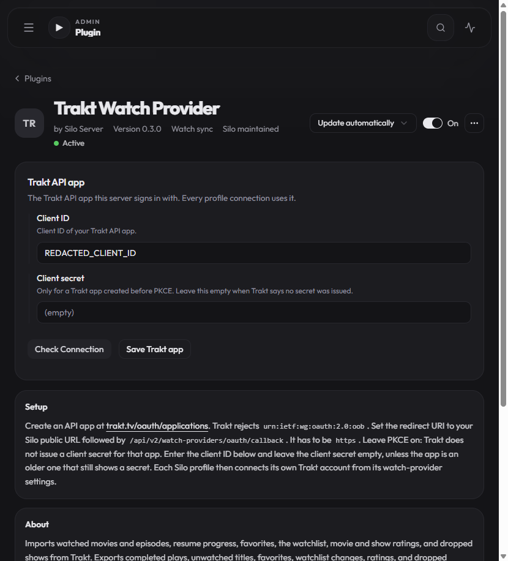
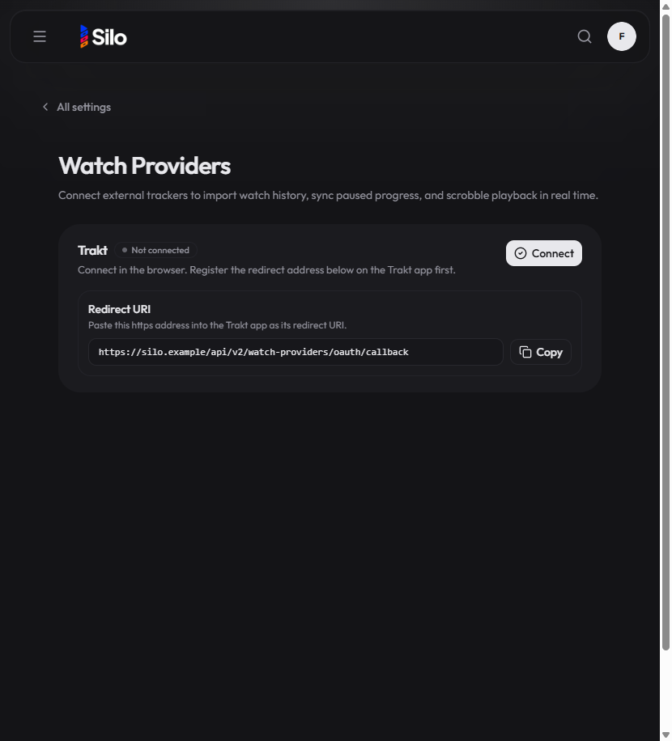

## Steps

1. Open Admin → Plugins → Trakt Watch Provider.
2. Confirm version 0.3.0, optional client secret copy, and https callback setup text.
3. Open profile Settings → Watch Providers and confirm Connect + Redirect URI.

## Captures

Client ID and deployment hostname were redacted before capture.

## Results

Previously the admin form required a client secret and oob redirect; Connect used device-code only.
